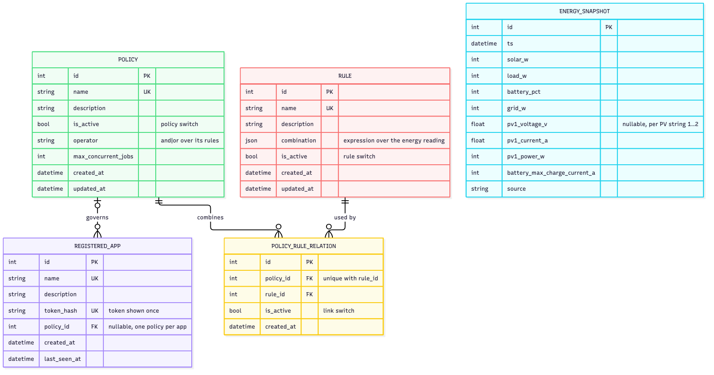

# LLM Task Director

A dispatcher service for a home server that runs local large language models (LLMs) on solar power. Heavy background LLM work (batch text processing, embeddings, fine-tuning, research runs) uses a lot of electricity. The Director tells that work *when* it may run: when the live readings from the solar inverter satisfy the conditions the operator has set.

What it manages:

- **Energy readings**: solar output, household load, battery charge and power, grid exchange, and per-string PV data, read from a Deye hybrid inverter over LAN (Solarman V5) and stored as an append-only history.
- **Registered apps**: external applications that ask the Director whether they may run now. The operator registers each app and assigns it one policy.
- **Rules**: reusable conditions over one energy reading, written as JSON expression trees (arithmetic, comparison, membership and logic operators over the reading's fields, the weekday and the local time). A rule is true or false.
- **Policies**: combine their rules with one operator (`and` / `or`) into a single decision. Rules and policies are many-to-many. Every rule, every policy and every policy↔rule link has its own `is_active` switch. Each app has one policy, and a policy can serve many apps.
- **Jobs**: LLM work items: the `model` to run, the public `data` URLs it works on, the `prompt`, and a `status` (`queued` → `in-process` → `success` / `failed`). For now jobs are plain records managed over the API; nothing dispatches them yet.

## Quick start

Requirements: Python 3.11+, [`uv`](https://docs.astral.sh/uv/), Docker.

```sh
cp .env.example .env            # fill in POSTGRES_PASSWORD, INVERTER_LOGGER_*, CORS_ALLOWED_ORIGINS
uv sync
docker compose up -d db         # shared Postgres 17
uv run python manage.py migrate
uv run python manage.py runserver   # http://127.0.0.1:8000/api/
```

- Admin (rule builder, policies): `http://127.0.0.1:8000/admin/` (create a user with `uv run python manage.py createsuperuser`).
- Tests (need the `db` container): `uv run python manage.py test src.director_app src.inverter_app`.
- Lint / format: `pyfmt --check src config`.
- Find the inverter logger's IP and serial: `src/inverter_app/inverter_service/detector.py` (needs `DEVICE_LAN_IP`, `BROADCAST`). Django won't start without `INVERTER_LOGGER_SERIAL` set in `.env`.

## Building a frontend

- **Contract**: [`postman/specs/director-api.yaml`](postman/specs/director-api.yaml) (OpenAPI 3.0) describes every endpoint, schema and error shape. Generate a typed client from it, e.g. `npx openapi-typescript postman/specs/director-api.yaml -o src/api/schema.d.ts`.
- **Examples**: the Postman collection `postman/collections/DirectorApp` (open the `postman/` folder in the Postman app) has a request with saved example responses for every endpoint, captured from the real API.
- **CORS**: list the frontend's origins in `.env` as `CORS_ALLOWED_ORIGINS=http://localhost:5173,http://127.0.0.1:5173` (comma-separated `scheme://host[:port]`, applies to `/api/` only), then restart the server. A dev-server proxy works too.
- **Auth**:
  - `POST /api/auth/register/` `{"username", "password"}` creates a read-only account (`201 {"id", "username", "role": "user"}`; Django password validators apply).
  - `POST /api/auth/token/` with the same fields returns `{"token": "<key>"}` (wrong credentials: `400 non_field_errors`); send it as `Authorization: Token <key>` (allowed by CORS). The token is the same on every login and never expires.
  - `POST /api/auth/logout/` deletes the token (`204`); every session of that user ends and the next login gets a new token.
  - Without a valid token every other endpoint answers `401` (`{"detail": "Authentication credentials were not provided."}` / `{"detail": "Invalid token."}`, header `WWW-Authenticate: Token`).
- **Roles**: `admin` (Django `is_staff`; the first one from `uv run python manage.py createsuperuser`) may call everything. `user` is read-only: `GET` only, and not `/apps/{id}/evaluate/`, `/energy/current/` (live inverter reads that store a snapshot) or `/users/`. Forbidden calls are `403 {"detail": "You do not have permission to perform this action."}`. Admins change roles with `PATCH /api/users/{id}/ {"role": "admin"|"user"}` (not their own: `409`).
- **Rule builder**: `GET /api/rules/catalog/` returns the fields and operators a rule may use (see [Rules](#rules)).

## API conventions

- Base URL `/api/`; request and response bodies are JSON.
- Resources are plural nouns; an action that is not CRUD is a sub-resource (`/apps/{id}/evaluate/`, `/rules/{id}/unlink/`).
- Lists are paginated: `?page=1&page_size=20` (max 100) → `{"count": 42, "next": "<url>|null", "previous": "<url>|null", "results": [...]}`. A page past the end is `404 {"detail": "Invalid page."}`. `/policies/{id}/apps/` and `/rules/catalog/` are not paginated.
- Errors:
  - `400`: messages per field, `{"name": ["This field is required."]}`. Errors inside a list are keyed by item index, `{"data": {"0": ["Enter a valid URL."]}}`.
  - `404`: `{"detail": "Not found."}`.
  - `409`: the action conflicts with the current state, `{"detail": "..."}`.
  - `503`: the inverter could not be read, `{"detail": "Failed to connect to inverter"}`.
- **Time**: every datetime in a response is ISO 8601 UTC with a `Z` suffix (`2026-11-04T10:00:00Z`, with microseconds when stored). Datetimes you send may carry any offset; without one they are read as UTC. Only inside rules is time local (`Europe/Kyiv`): the `weekday` / `local_time` fields and offset-less datetime constants.
- Units: power in W, voltage in V, current in A, battery charge in %.

## Endpoints

| Method | URL | Purpose |
|---|---|---|
| POST | `/api/auth/register/` | Create a read-only account (no token needed) |
| POST | `/api/auth/token/` | Log in → token (no token needed) |
| POST | `/api/auth/logout/` | Delete the caller's token |
| GET | `/api/users/` | List users (`search`), admin only |
| GET, PATCH, DELETE | `/api/users/{id}/` | One user; `PATCH` changes `role`; admin only, not yourself |
| GET, POST | `/api/apps/` | List (`search`) / register apps |
| GET, PUT, PATCH, DELETE | `/api/apps/{id}/` | One app |
| GET | `/api/apps/{id}/evaluate/` | May the app run now? (live inverter read) |
| GET, POST | `/api/rules/` | List (`is_active`, `search`) / create rules |
| GET | `/api/rules/catalog/` | Fields and operators for building rules |
| GET, PUT, PATCH, DELETE | `/api/rules/{id}/` | One rule (`DELETE` → `409` while linked) |
| POST | `/api/rules/{id}/unlink/` | Remove the rule from every policy |
| GET, POST | `/api/policies/` | List (`is_active`, `search`) / create policies |
| GET, PUT, PATCH, DELETE | `/api/policies/{id}/` | One policy (`DELETE` → `409` while apps use it) |
| GET | `/api/policies/{id}/apps/` | Apps that use the policy |
| GET, POST | `/api/jobs/` | List (`status`) / create jobs |
| GET, PUT, PATCH, DELETE | `/api/jobs/{id}/` | One job |
| GET, POST | `/api/energy/snapshots/` | Reading history (`from`, `to`) / store a reading |
| GET | `/api/energy/current/` | Live reading (stored as a snapshot) |

`PUT` needs every required field; `PATCH` takes any subset. `is_active` filters accept `true` / `false` / `1` / `0`; any other value is `400`.

### Registered apps

| Field | Type | Notes |
|---|---|---|
| `id` | int | read-only |
| `name` | string ≤ 100 | required, unique |
| `description` | string | default `""` |
| `policy` | int, nullable | policy id; `null` = no policy, so the app can't run |
| `created_at` | datetime | read-only |

```json
{"id": 1, "name": "doc-indexer", "description": "Nightly embeddings for the home wiki",
 "policy": 1, "created_at": "2026-11-04T10:00:00Z"}
```

Deleting an app keeps its jobs (their `app` becomes `null`) and its policy.

**GET `/api/apps/{id}/evaluate/`**: reads the inverter live, stores the reading as a snapshot, and evaluates the app's policy against it:

```json
{"can_run": true,
 "energy": {"id": 1, "timestamp": "2026-11-04T10:00:00Z", "solar_power_w": 2350, "load_power_w": 640,
            "grid_power_w": -120, "battery_power_w": -1590, "battery_charge_pct": 78, "...": "..."},
 "policy": {"policy": 1, "operator": "and", "passed": true,
            "rules": [{"rule": 1, "name": "Sunny", "passed": true}]}}
```

- `policy.rules` lists only the policy's effective rules (rule and link both active). `passed` combines them with `operator`, and a policy without effective rules does not pass.
- Without an active policy the response is `can_run: false` with `"policy": null`.
- Every call writes a snapshot, so don't poll it fast.
- Errors: `404` (app not found), `503` (inverter unreachable).

### Rules

| Field | Type | Notes |
|---|---|---|
| `id` | int | read-only |
| `name` | string ≤ 100 | required, unique |
| `description` | string | default `""` |
| `combination` | object | required; expression tree, see below |
| `is_active` | bool | default `true` |
| `created_at`, `updated_at` | datetime | read-only |

```json
{"id": 1, "name": "Sunny", "description": "Solar output above 1.5 kW",
 "combination": {"ge": [{"field": "solar_power_w"}, 1500]},
 "is_active": true, "created_at": "2026-11-04T10:00:00Z", "updated_at": "2026-11-04T10:00:00Z"}
```

- A change to a rule applies to every policy it is linked to.
- `DELETE` returns `409` while the rule is linked to any policy, so a policy's decision can't change silently. `POST /api/rules/{id}/unlink/` deletes all of the rule's links (`204`; the rule and the policies stay).
- The Django admin (`/admin/director_app/rule/`) has a visual rule builder.

**Expression grammar.** Every operator node is a single-key object `{"op": [arguments]}`:

| Kind | Operators | Arguments → result |
|---|---|---|
| logic | `and`, `or` (one or more), `not` (exactly one) | conditions → condition |
| comparison | `eq` =, `ne` ≠, `gt` >, `ge` ≥, `lt` <, `le` ≤ | two values of the same type → condition |
| membership | `in` | a field and a non-empty list of constants → condition |
| arithmetic | `add` +, `sub` −, `mul` ×, `div` ÷ | two numbers → number |

Operands are `{"field": "<name>"}`, a number, or a string. A string is typed by the other side of the comparison: `"HH:MM"` for `time`, ISO 8601 for `datetime` (no offset = local time). The root must be a condition, every comparison must use at least one field, and both sides must have the same type. Invalid trees are rejected with `400` and the path of the bad node, e.g. `{"combination": ["and[1].ge[0].field: unknown field 'nope'"]}`.

**Fields.** `GET /api/rules/catalog/` returns them in machine-readable form (`{"fields": [{name, type, nullable, description}], "operators": [{op, kind, symbol, types}]}`), derived from the code:

| Field | Type | Meaning |
|---|---|---|
| `solar_power_w`, `load_power_w`, `battery_charge_pct`, `battery_voltage_v`, `grid_voltage_v` | number | Inverter reading |
| `grid_power_w` | number | + import from the grid, − export |
| `battery_power_w` | number | + discharging, − charging |
| `pv1_voltage_v`, `pv1_current_a`, `pv1_power_w`, `pv2_*`, `battery_max_charge_current_a` | number, nullable | Per-string PV operating point and the battery charge limit (null on old readings) |
| `timestamp` | datetime | When the reading was taken |
| `weekday` | number | `0` = Monday … `6` = Sunday, local time |
| `local_time` | time | Time of day, local time |

Example: weekdays, at night, both PV strings together above 2 kW, no grid import:

```json
{"and": [
  {"in": [{"field": "weekday"}, [0, 1, 2, 3, 4]]},
  {"or": [{"ge": [{"field": "local_time"}, "22:00"]},
          {"lt": [{"field": "local_time"}, "06:00"]}]},
  {"gt": [{"add": [{"field": "pv1_power_w"}, {"field": "pv2_power_w"}]}, 2000]},
  {"le": [{"field": "grid_power_w"}, 0]}
]}
```

**Missing readings fail closed.** A null field or a division by zero makes a comparison *unknown*. `not` keeps it unknown, `and` / `or` decide only when another condition settles the result, and a rule passes only when the result is exactly true.

> `solar_power_w` follows consumption, not availability: the panels curtail when nothing uses the power. So `solar − load` is not a surplus, and a high-solar rule can fail exactly when the battery is full and the house is idle.

### Policies

| Field | Type | Notes |
|---|---|---|
| `id` | int | read-only |
| `name` | string ≤ 100 | required, unique |
| `description` | string | default `""` |
| `operator` | `and` / `or` | default `and`: `and` needs every effective rule, `or` needs one |
| `is_active` | bool | default `true`; an inactive policy makes its apps unable to run |
| `max_concurrent_jobs` | int ≥ 1, nullable | stored, not enforced yet |
| `apps_count` | int | read-only |
| `rules` | list | links, see below |
| `created_at`, `updated_at` | datetime | read-only |

`rules` is written as `[{"rule": <rule id>, "is_active": true}]` (`is_active` optional, default `true`; each rule at most once). It is read as:

```json
{"id": 1, "name": "Sunny weekdays", "description": "Daytime solar only", "operator": "and",
 "is_active": true, "max_concurrent_jobs": 1, "apps_count": 1,
 "rules": [{"rule": {"id": 1, "name": "Sunny", "is_active": true}, "is_active": true, "effective": true},
           {"rule": {"id": 2, "name": "Weekday daytime", "is_active": true}, "is_active": false, "effective": false}],
 "created_at": "2026-11-04T10:00:00Z", "updated_at": "2026-11-04T10:05:00Z"}
```

- In a link, `is_active` is the link's own switch. `effective` is true when the link and the rule are both active, and only effective rules are evaluated.
- When `rules` is sent (POST / PUT / PATCH), it **replaces** all of the policy's links (`[]` removes them). When it is left out, the links stay.
- `DELETE` returns `409` while apps use the policy. Move the apps to another policy (or to `null`) first.
- `GET /api/policies/{id}/apps/` → `[{"id": 1, "name": "doc-indexer"}]`.

### Jobs

| Field | Type | Notes |
|---|---|---|
| `id` | int | read-only |
| `app` | int, nullable | owning app; becomes `null` when the app is deleted |
| `model` | string ≤ 200 | required; LLM model name |
| `data` | list of URLs | required, non-empty; public `http(s)` URLs (≤ 2048 chars each) |
| `prompt` | string | required |
| `status` | `queued` / `in-process` / `success` / `failed` | default `queued` |
| `created_at`, `updated_at` | datetime | read-only |

```json
{"id": 1, "app": 1, "model": "llama3.1:8b", "data": ["https://example.com/docs/report.pdf"],
 "prompt": "Summarize the document in five bullet points.", "status": "queued",
 "created_at": "2026-11-04T10:00:00Z", "updated_at": "2026-11-04T10:00:00Z"}
```

`GET /api/jobs/?status=…` filters by status; any other value is `400`. Nothing runs jobs yet: `status` is set by whoever calls the API.

### Energy readings

| Field | Type | Notes |
|---|---|---|
| `id` | int | read-only |
| `timestamp` | datetime | required on POST |
| `solar_power_w`, `load_power_w` | int | required |
| `grid_power_w` | int | required; + import, − export |
| `battery_power_w` | int | required; + discharging, − charging |
| `battery_charge_pct` | int | required |
| `battery_voltage_v`, `grid_voltage_v` | float | required |
| `pv1_voltage_v`, `pv1_current_a`, `pv2_voltage_v`, `pv2_current_a` | float, nullable | optional |
| `pv1_power_w`, `pv2_power_w`, `battery_max_charge_current_a` | int, nullable | optional |

- `GET /api/energy/snapshots/`: newest first. `from` / `to` are inclusive ISO 8601 bounds on `timestamp` (no offset = UTC); a malformed value is `400`.
- `POST /api/energy/snapshots/`: stores a reading from an external collector (`201`).
- `GET /api/energy/current/`: reads the inverter now and stores the reading (`503` if unreachable). For dashboards, prefer the newest item of `/snapshots/`: the worker below collects one every few minutes.

**Inverter worker.** The `inverter-worker` container (`deploy/inverter_worker/`, supercronic) runs `collect_energy_snapshot` every `INVERTER_WORKER_CRON_CYCLE_MINUTES` minutes (`.env`, 1–59, default 5; values that don't divide 60 also restart at each full hour). The snapshots are training data for a future recommendation system. It writes to the compose `db`; run `migrate` from the host first:

```sh
docker compose up -d db inverter-worker
docker compose logs -f inverter-worker
```

**PV estimate (proof of concept).** `uv run python manage.py compare_pv_estimate --date YYYY-MM-DD [--csv out.csv]` compares one day of snapshots with satellite irradiance (Open-Meteo) and the clear-sky ceiling (pvlib). It uses the per-string PV data to tell curtailed readings from unconstrained ones, and needs the `PV_SITE_*` keys from `.env.example`.

## Database schema

Postgres runs in Docker (`compose.yaml`, connection settings `POSTGRES_*` in `.env`). Project tables live in the `apps` schema and Django's built-in tables in `public`. `db.sqlite3` is the legacy pre-Postgres database, kept for reference.



The diagram is rendered from [`docs/db-schema.mmd`](docs/db-schema.mmd):
`npx -y @mermaid-js/mermaid-cli -i docs/db-schema.mmd -o docs/db-schema.png -b white -s 2`.

- One policy → many registered apps (`REGISTERED_APP.policy_id`, nullable; a policy can't be deleted while apps use it).
- Policies ↔ rules: many-to-many through `POLICY_RULE_RELATION` (`policy_id`, `rule_id`, unique pair, own `is_active`). A rule can't be deleted over the API while it is linked.
- One registered app → many jobs (`JOB.app_id`, nullable; deleting the app keeps its jobs).
- `ENERGY_SNAPSHOT` is standalone and append-only: the worker, `/energy/current/` and every evaluation add a row.

## Repository layout

- `config/`: Django settings (DRF token auth + role permission for every endpoint) and root URLs (`admin/`, `api/` → accounts_app, `api/energy/` → inverter_app, `api/` → director_app).
- `src/accounts_app/`: registration, login, logout, users and roles.
- `src/director_app/`: apps, rules (engine in `rules.py`), policies, jobs, evaluation, admin rule builder.
- `src/inverter_app/`: energy snapshots, `/api/energy/`, Solarman inverter client, curtailment / irradiance proof of concept.
- `src/utils/`: shared helpers (logging, DB schema names, UTC serializer base).
- `postman/`: OpenAPI spec (`specs/director-api.yaml`) and the Postman collection (`collections/DirectorApp`).
- `deploy/inverter_worker/`: the snapshot collector image.
- `docs/`: database diagram.
- `AGENTS.md` files: working contracts for contributors and coding agents.
