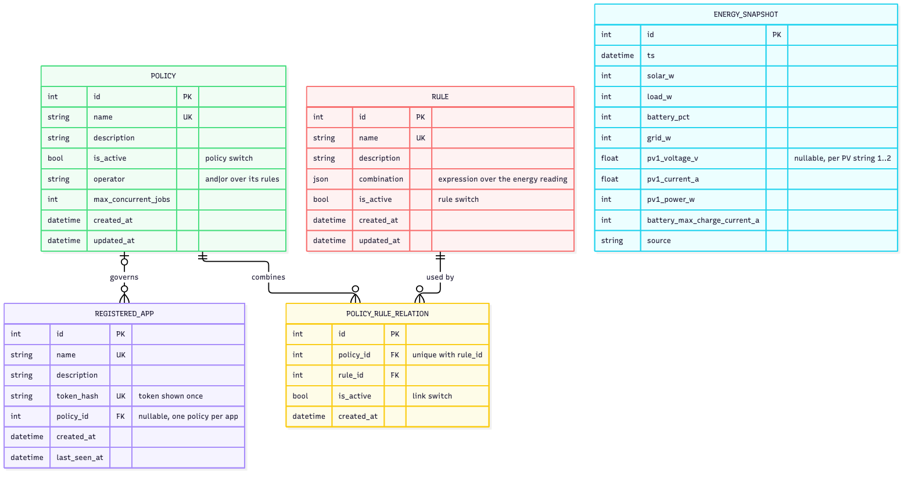

# LLM Task Director

## Description

**LLM Task Director** is a "dispatcher" service for a home server running local large language models (LLMs) and powered by solar panels.

Heavy background LLM jobs (batch text processing, building embeddings, fine-tuning, research runs) consume a lot of electricity. The idea of the site is to run them when energy is effectively free: the solar panels produce more than the house consumes and the battery is sufficiently charged. If there is not enough energy, a job waits in the queue, and it can be started by force if needed.

What the site contains (business logic):

- **Energy system status** — current solar output, household consumption, battery charge, grid exchange, and the history of these readings.
- **Job types** — kinds of work (for example "batch generation", "embeddings", "fine-tuning") with their average energy consumption and duration. These figures are refined after every completed run.
- **Jobs** — concrete tasks submitted by the user for local models. Each job has a mode:
  - `defer` — run only when there is surplus energy;
  - `opportunistic` — run on surplus, or when the deadline approaches;
  - `force` — start immediately regardless of energy.
- **Energy forecast** — before creating a job you can find out how many kWh and how much time it will likely need.
- **Registered apps** — external applications that send jobs to the Director. An app is registered manually by the operator and is assigned one active policy; requests from unregistered apps, or from apps without an active policy, are rejected.
- **Rules** — reusable conditions over one energy reading, built in the Django admin: arithmetic, comparison and logic operators over the reading's fields (solar output, battery charge, grid exchange, PV strings, weekday, local time …). A rule is True or False.
- **Policies** — named run configurations: a policy combines its rules with one logic operator (`and` / `or`) into a single True / False and caps how many of the app's jobs may run at once. Rules and policies are many-to-many; rules, policies and each policy↔rule link can be switched on and off (`is_active`). Every app has one policy; a policy can serve many apps.
- **Dispatcher decisions** — an explanation of why a job was started or why it is waiting, plus an event log for each job.

## General API rules

- Base URL: `/api/`. All data is exchanged as **JSON** (`Content-Type: application/json`).
- Resources are plural nouns; actions on a resource that do not fit CRUD are sub-resources (`/jobs/{id}/cancel/`).
- Lists support pagination: `?page=1&page_size=20`. List response:
  `{"count": 42, "next": "...", "previous": null, "results": [ ... ]}`.
- Validation error: `400` + `{"field": ["message"]}`; not authenticated: `401`; forbidden: `403`; not found: `404` + `{"detail": "Not found."}`; state conflict: `409` + `{"detail": "..."}`.
- Time is ISO 8601 (UTC), power is in watts (`W`), energy is in kWh.
- Access levels:
  - **operator** — the Director owner: a Django staff user, via HTTP Basic or session authentication. Only the operator manages apps and policies (`/api/apps/…`, `/api/policies/…`); apps calling these endpoints get `403`.
  - **app** — requests from registered apps carry `Authorization: Bearer <app token>` and must pass the [admission gate](#registered-apps) (`401` — app not registered, `403` — app has no active policy).

## Endpoints

### Energy system status

| Method | URL | Purpose |
|---|---|---|
| GET | `/api/energy/snapshots/` | History of system readings |
| POST | `/api/energy/snapshots/` | Add a new snapshot (sent by the inverter / Home Assistant) |
| GET | `/api/energy/current/` | Current state |

**GET `/api/energy/snapshots/`**
- Parameters: `from`, `to` (datetime), `page`, `page_size`.
- Response `200`:
```json
{
  "count": 1, "next": null, "previous": null,
  "results": [
    {"id": 1, "ts": "2026-10-11T10:00:00Z", "solar_w": 3200, "load_w": 900,
     "battery_pct": 82, "grid_w": 0}
  ]
}
```

**POST `/api/energy/snapshots/`**
- Body:
```json
{"ts": "2026-10-11T10:00:00Z", "solar_w": 3200, "load_w": 900,
 "battery_pct": 82, "grid_w": 0}
```
- Response: `201` + the created object; `400` — invalid data (e.g. `battery_pct` outside 0–100).

**GET `/api/energy/current/`**
- Response `200` (or `404` if there are no snapshots yet):
```json
{"ts": "2026-10-11T10:00:00Z", "solar_w": 3200, "load_w": 900,
 "battery_pct": 82}
```

Snapshots also carry the per-string PV operating point and the battery charge limit (`pv1_voltage_v`, `pv1_current_a`, `pv1_power_w`, `pv2_*`, `battery_max_charge_current_a`; `null` on older rows). They are used to tell curtailed solar readings from ones that show the real available power. The `inverter-worker` container (`deploy/inverter_worker/`, supercronic) stores one snapshot every `INVERTER_WORKER_CRON_CYCLE_MINUTES` minutes (`.env`, default 5; values that don't divide 60 also restart at each full hour) as training data. It writes to the compose `db` service; run `migrate` from the host first:
```
docker compose up -d db inverter-worker
docker compose logs -f inverter-worker
```
`uv run python manage.py compare_pv_estimate --date YYYY-MM-DD [--csv out.csv]` is a proof of concept. It compares one day of snapshots with satellite irradiance (Open-Meteo) and the clear-sky ceiling (pvlib), and needs the `PV_SITE_*` keys from `.env.example`.

---

### Job types

| Method | URL | Purpose |
|---|---|---|
| GET | `/api/job-types/` | List types |
| POST | `/api/job-types/` | Create a type |
| GET | `/api/job-types/{id}/` | Get one type |
| PUT / PATCH | `/api/job-types/{id}/` | Update a type |
| DELETE | `/api/job-types/{id}/` | Delete a type |

- POST/PUT body:
```json
{"name": "embeddings", "avg_kwh": 0.35, "avg_duration_s": 1800}
```
- Response `200`/`201`:
```json
{"id": 2, "name": "embeddings", "avg_kwh": 0.35, "avg_duration_s": 1800, "runs_count": 0}
```
- Statuses: `200` (GET, PUT, PATCH), `201` (POST), `204` (DELETE, no body), `400`, `404`, `409` — a type cannot be deleted while jobs reference it.

---

### Registered apps

**Admission gate.** A request from an app is processed **only** if the app was **manually registered** in the Director by the operator **and** its assigned policy is active (`app.policy` set and `policy.is_active`).
- Apps cannot register themselves — there is no self-signup endpoint; all endpoints below are operator-only.
- Missing or unknown token → `401` `{"detail": "App is not registered."}`.
- Registered app without an active policy (none assigned, or the policy is inactive) → `403` `{"detail": "App has no active policy."}`. The request is rejected, not queued.
- Once the gate is passed, the app's policy decides *when* the work runs.

| Method | URL | Purpose |
|---|---|---|
| GET | `/api/apps/` | List registered apps |
| POST | `/api/apps/` | Register an app (manual, operator only) |
| GET | `/api/apps/{id}/` | Get one app |
| PATCH | `/api/apps/{id}/` | Update `name` / `description` / `policy` |
| DELETE | `/api/apps/{id}/` | Unregister an app (its policy stays) |
| POST | `/api/apps/{id}/rotate-token/` | Issue a new token, the old one stops working |
| GET | `/api/apps/{id}/evaluate/` | Could the app run right now (dry run, nothing is started) |

**GET `/api/apps/`**
- Parameters: `search` (by name), `page`, `page_size`.
- Response `200`: paginated list of app objects (format below, without `token`).

**POST `/api/apps/`**
- Body:
```json
{"name": "doc-indexer", "description": "Nightly embeddings for the home wiki", "policy": 3}
```
- `policy` — id of the app's policy, optional (`null` until one is assigned).
- Response `201` — `token` is returned **only once**, the Director stores just its hash:
```json
{"id": 4, "name": "doc-indexer", "description": "Nightly embeddings for the home wiki",
 "policy": 3, "token": "tdk_9f2c1e7a4b0d4c58a1e3",
 "created_at": "2026-10-11T09:00:00Z", "last_seen_at": null}
```
- Errors: `400` (empty or duplicate `name`, unknown `policy`).

**GET `/api/apps/{id}/`** — `200` + app object (without `token`), `404`.

**PATCH `/api/apps/{id}/`** — body: any of `name`, `description`, `policy` (`{"policy": 3}` assigns a policy, `{"policy": null}` removes it); `200` + updated object; `400`; `404`.

**DELETE `/api/apps/{id}/`** — `204`; `404`. The app's policy stays.

**POST `/api/apps/{id}/rotate-token/`**
- Body: none. Response `200`: app object with a new one-time `token`; `404`.

**GET `/api/apps/{id}/evaluate/`**
- Reads the inverter live (the reading is saved as an energy snapshot) and evaluates the app's policy against it; time rules use the reading's `timestamp`.
- Response `200`:
```json
{"can_run": false,
 "energy": {"timestamp": "2026-10-14T20:30:00Z", "solar_power_w": 3200, "battery_charge_pct": 82, "grid_power_w": 0, "...": "..."},
 "policy": {"policy": 3, "operator": "and", "passed": false,
            "rules": [{"rule": 1, "name": "Sunny", "passed": true},
                      {"rule": 2, "name": "Weekday daytime", "passed": false}]}}
```
- `rules` lists the policy's effective rules (rule and link both active); `passed` combines them with `operator`. A policy without effective rules does not pass.
- `can_run` is `policy.passed`. An app without an active policy returns `can_run: false` and `"policy": null`.
- Errors: `404` — the app does not exist; `503` — the inverter is unreachable.

---

### Jobs

| Method | URL | Purpose |
|---|---|---|
| GET | `/api/jobs/` | List jobs |
| POST | `/api/jobs/` | Put a job in the queue |
| GET | `/api/jobs/{id}/` | Job details |
| PATCH | `/api/jobs/{id}/` | Update a job (only while `queued`) |
| DELETE | `/api/jobs/{id}/` | Delete a job (only finished/cancelled) |
| POST | `/api/jobs/estimate/` | Energy and time forecast |
| POST | `/api/jobs/{id}/force-start/` | Start by force |
| POST | `/api/jobs/{id}/cancel/` | Cancel a job |
| POST | `/api/jobs/{id}/complete/` | Worker reports completion |
| GET | `/api/jobs/{id}/events/` | Job event log |

**GET `/api/jobs/`**
- Parameters: `status` (`queued|running|done|failed|cancelled`), `mode` (`defer|opportunistic|force`), `job_type` (id), `ordering` (`priority`, `-priority`, `deadline`, `created_at`), `search` (by name), `page`, `page_size`.
- Response `200`: paginated list of job objects (format below).

**POST `/api/jobs/`**
- Body:
```json
{"name": "Embed docs batch 7", "job_type": 2, "mode": "defer", "priority": 5,
 "deadline": "2026-10-12T18:00:00Z", "payload": {"model": "bge-m3", "input": "s3://docs/7"}}
```
- Response `201`:
```json
{"id": 15, "name": "Embed docs batch 7", "job_type": 2, "mode": "defer", "priority": 5,
 "status": "queued", "deadline": "2026-10-12T18:00:00Z",
 "payload": {"model": "bge-m3", "input": "s3://docs/7"},
 "predicted_kwh": 0.35, "actual_kwh": null, "reason": null,
 "created_at": "2026-10-11T10:05:00Z", "started_at": null, "finished_at": null}
```
- Errors: `400` (unknown type, invalid mode, deadline in the past).

**GET `/api/jobs/{id}/`** — `200` + job object, `404`.

**PATCH `/api/jobs/{id}/`**
- Body: any of `name`, `mode`, `priority`, `deadline`, `payload`.
- Response: `200` + updated object; `400`; `404`; `409` — the job is no longer `queued`.

**DELETE `/api/jobs/{id}/`** — `204`; `404`; `409` — the job is `queued`/`running` (cancel it first).

**POST `/api/jobs/estimate/`**
- Body: `{"job_type": 2, "payload": {"batch_size": 64}}`
- Response `200`: `{"predicted_kwh": 0.35, "predicted_duration_s": 1800, "predicted_power_w": 700}`; `400`.

**POST `/api/jobs/{id}/force-start/`**
- Body: none.
- Response `200`: job object with `status: "running"` and `reason: "forced by user"`.
- Errors: `404`; `409` — the job is not `queued`.

**POST `/api/jobs/{id}/cancel/`**
- Body: none. Response `200`: job object with `status: "cancelled"`; `404`; `409` — the job has already finished.

**POST `/api/jobs/{id}/complete/`**
- Body: `{"success": true, "actual_kwh": 0.31, "duration_s": 1650}`
- Response `200`: job object with `status: "done"` (or `"failed"`) and `actual_kwh`. The job type's averages are updated.
- Errors: `400`; `404`; `409` — the job is not `running`.

**GET `/api/jobs/{id}/events/`**
- Response `200`:
```json
[{"id": 1, "ts": "2026-10-11T10:05:00Z", "kind": "queued", "message": "Job created"},
 {"id": 2, "ts": "2026-10-11T10:06:00Z", "kind": "waiting", "message": "Surplus 300 W < required 700 W"},
 {"id": 3, "ts": "2026-10-11T11:00:00Z", "kind": "started", "message": "Surplus 2300 W, battery 82%"}]
```
- `404` if the job does not exist.

---

### Policies

A policy combines rules into one decision and is assigned to apps (see [Registered apps](#registered-apps)). All endpoints are operator-only; rules and policy↔rule links are managed in the Django admin (see [Rules](#rules)).

| Method | URL | Purpose |
|---|---|---|
| GET | `/api/policies/` | List policies |
| POST | `/api/policies/` | Create a policy |
| GET | `/api/policies/{id}/` | Get one policy |
| PUT / PATCH | `/api/policies/{id}/` | Update a policy (e.g. `{"is_active": false}`) |
| DELETE | `/api/policies/{id}/` | Delete a policy |
| GET | `/api/policies/{id}/apps/` | Apps the policy is assigned to |

| Field | Type | Meaning |
|---|---|---|
| `operator` | `and` / `or` | `and` — every effective rule must pass; `or` — one is enough. Default `and` |
| `max_concurrent_jobs` | int | Running jobs of the app at the same time (not checked until jobs are connected to apps) |
| `rules` | list, read-only | Linked rules: `{"rule": {"id", "name", "is_active"}, "is_active", "effective"}`; `is_active` is the link switch, `effective` = link and rule both active |

**GET `/api/policies/`**
- Parameters: `is_active`, `search` (by name), `page`, `page_size`.
- Response `200`: paginated list of policy objects (format below).

**POST `/api/policies/`**
- Body:
```json
{"name": "Sunny weekdays", "description": "Daytime surplus only", "is_active": true,
 "operator": "and", "max_concurrent_jobs": 1}
```
- Response `201`: the same object plus `id`, `apps_count`, `rules`, `created_at`, `updated_at`:
```json
{"id": 3, "name": "Sunny weekdays", "description": "Daytime surplus only", "operator": "and",
 "is_active": true, "max_concurrent_jobs": 1, "apps_count": 0,
 "rules": [{"rule": {"id": 1, "name": "Sunny", "is_active": true}, "is_active": true, "effective": true}],
 "created_at": "2026-10-11T09:00:00Z", "updated_at": "2026-10-11T09:00:00Z"}
```
- Errors: `400` — duplicate `name`, `operator` other than `and` / `or`, `max_concurrent_jobs` below 1.

**GET `/api/policies/{id}/`** — `200` + policy object, `404`.

**PUT / PATCH `/api/policies/{id}/`** — body as in POST (PATCH: any subset; `rules` is ignored); `200` + updated object; `400`; `404`. Setting `"is_active": false` turns the policy off for every app it is assigned to.

**DELETE `/api/policies/{id}/`** — `204`; `404`; `409` — the policy is still assigned to apps (move them to another policy first).

**GET `/api/policies/{id}/apps/`**
- Response `200`:
```json
[{"id": 4, "name": "doc-indexer"}]
```
- `404` if the policy does not exist.

> Connecting jobs to apps (which policy governs a job) will be added in a later step; until then the Jobs endpoints above are unchanged.

---

### Rules

Rules have no REST endpoints: they are created in the Django admin (`/admin/director_app/rule/`) with a rule builder that lists the available fields and only offers the operators each field type allows. On the policy page in the admin, rules are linked to the policy (each link has its own `is_active`).

A rule is stored as a JSON expression tree in `combination`; every operator node is a single-key object `{"op": [arguments]}`:

| Kind | Operators | Arguments → result |
|---|---|---|
| logic | `and`, `or` (one or more conditions), `not` (one condition) | conditions → condition |
| comparison | `eq` (=), `ne` (≠), `gt` (>), `ge` (≥), `lt` (<), `le` (≤) | two values → condition |
| membership | `in` | a value and a non-empty list of constants → condition |
| arithmetic | `add` (+), `sub` (−), `mul` (×), `div` (÷) | two numbers → number |

Operands: `{"field": "<name>"}`, a number, or a string — `"HH:MM"` for time fields, ISO 8601 for `timestamp` (without an offset it is local time). The root must be a condition, every comparison must use at least one field, and both sides must have the same type (number, time or datetime). The admin rejects invalid rules with the path of the bad node, e.g. `and[1].ge[0]: unknown field 'nope'`.

Fields are the fields of the energy reading (`EnergySnapshotSchema`, without `id`) plus two local-time fields; local time is the project `TIME_ZONE` (Europe/Kyiv):

| Field | Type | Meaning |
|---|---|---|
| `solar_power_w`, `load_power_w`, `grid_power_w`, `battery_power_w`, `battery_charge_pct`, `battery_voltage_v`, `grid_voltage_v` | number | Inverter reading; `grid_power_w` positive = import, `battery_power_w` negative = charging |
| `pv1_*`, `pv2_*`, `battery_max_charge_current_a` | number, may be empty | Per-string PV operating point and the battery charge limit |
| `timestamp` | datetime | When the reading was taken (absolute date windows) |
| `weekday` | number | `0` = Monday … `6` = Sunday, local time |
| `local_time` | time | Time of day, local time |

Example — weekdays, at night, both PV strings together above 2 kW, no grid import:
```json
{"and": [
  {"in": [{"field": "weekday"}, [0, 1, 2, 3, 4]]},
  {"or": [{"ge": [{"field": "local_time"}, "22:00"]},
          {"lt": [{"field": "local_time"}, "06:00"]}]},
  {"gt": [{"add": [{"field": "pv1_power_w"}, {"field": "pv2_power_w"}]}, 2000]},
  {"le": [{"field": "grid_power_w"}, 0]}
]}
```

**Missing readings fail closed.** An empty field (e.g. `pv1_voltage_v` on old snapshots) or a division by zero makes a comparison *unknown*; `not` keeps it unknown, `and` / `or` decide only when another condition settles the result, and a rule passes only when the result is exactly true.

> `solar_power_w` follows consumption (the panels curtail when nothing uses the power), so a high-solar rule can fail exactly when the battery is full and the house is idle.

---

### Dispatcher decisions

| Method | URL | Purpose |
|---|---|---|
| GET | `/api/scheduler/decision/` | What the dispatcher would do right now (dry run, nothing is started) |

**GET `/api/scheduler/decision/`**
- Response `200`:
```json
{"energy": {"solar_w": 3200, "load_w": 900, "battery_pct": 82},
 "decisions": [
   {"job_id": 15, "decision": "START", "reason": "Solar 3200 W, battery above floor"},
   {"job_id": 16, "decision": "WAIT", "reason": "Concurrent jobs limit reached"}
 ]}
```
- `decision` ∈ `START | WAIT | FORCE_START`. `404` if there are no energy snapshots.

## Database schema

Postgres runs in Docker (`compose.yaml`, connection settings `POSTGRES_*` in `.env`): `docker compose up -d db`, then `uv run python manage.py migrate`. Project tables live in the `apps` schema, Django's built-in tables in `public`.



The diagram is rendered from [`docs/db-schema.mmd`](docs/db-schema.mmd):
`npx -y @mermaid-js/mermaid-cli -i docs/db-schema.mmd -o docs/db-schema.png -b white -s 2`.

Relations:
- one job type → many jobs (`JOB.job_type_id`); one job → many events (`JOB_EVENT.job_id`);
- one policy → many registered apps (`REGISTERED_APP.policy_id`, nullable; a policy cannot be deleted while apps use it);
- policies ↔ rules — many-to-many through `POLICY_RULE_RELATION` (`policy_id`, `rule_id`, unique pair). The link has its own `is_active`, and so do every rule and policy; a rule counts for a policy only when the link and the rule are active;
- `ENERGY_SNAPSHOT` is standalone and append-only: every evaluation reads the inverter live, saves the reading, and evaluates the app's policy against it.
